

  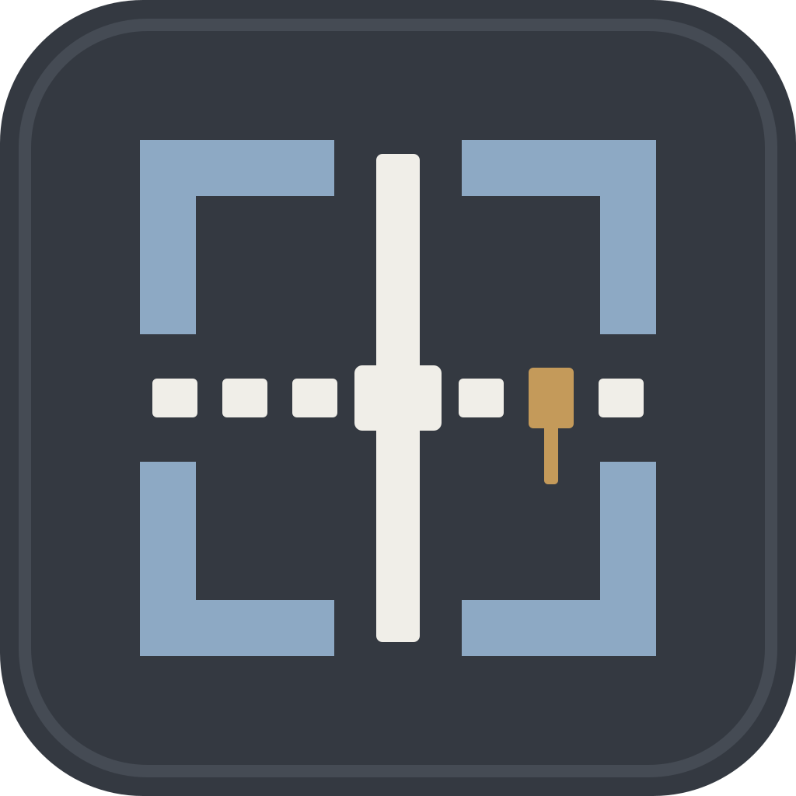

<h1 align="center">TimeCue</h1>

  <strong>Timecode-driven show control for Resolume Arena.</strong> 
  Fire clips and columns, and set or fade any Resolume parameter from LTC or MTC — with the show clock always in view.

  

  
  
  
  

  <a href="#download">Download</a> ·
  <a href="#whats-new-in-09">What's new</a> ·
  <a href="#features">Features</a> ·
  <a href="#interface">Interface</a> ·
  <a href="#quick-start">Quick start</a> ·
  <a href="#bitfocus-companion">Companion</a>

---

TimeCue is a desktop companion for timecode-driven Resolume shows on Windows, macOS and Linux. It listens to LTC from an audio interface or MTC from MIDI and RTP-MIDI sessions, keeps the incoming clock visible, triggers clips and columns, and sets or fades any parameter in the composition — effects, opacity, blend modes, colours — locked to the timecode.

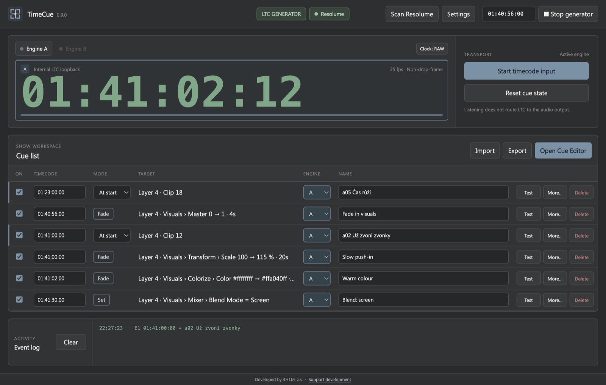

## Download

Get **[the latest TimeCue release](https://github.com/4H1Mzs/TimeCue-Releases/releases/latest)** from the Releases page.

- **Windows x64** — per-user NSIS installer with in-app updates. Windows packages are currently unsigned and may show a SmartScreen warning.
- **macOS Intel and Apple Silicon** — signed and notarized DMG and ZIP packages.
- **Linux x64** — portable AppImage.
- **Bitfocus Companion** — offline `.tgz` module package.

`latest.yml`, `latest-mac.yml` and `latest-linux.yml` are the public update manifests used by TimeCue. `SHA256SUMS.txt` contains checksums for every published artifact.

> [!IMPORTANT]
> TimeCue is preview software. Test the exact build, audio interface, timecode source and Resolume composition before using it in a live show.

## What's new in 0.10

### Web remote

Prepare cues from your own computer while someone else works in Resolume on the show computer. TimeCue serves its Cue Editor and a control page to browsers in the same network: live clock, next and last cue, Resolume status, Listen, Generator, and Fire and Edit for each cue. It is off by default and protected by an access token. See [Web remote](#web-remote) below.

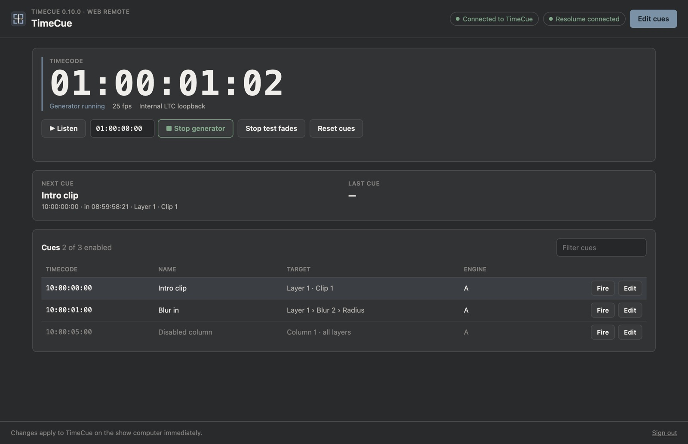

## What's new in 0.9

### Set and fade any Resolume parameter

A cue can now target **any parameter** in the open composition instead of only a clip or column: effect parameters, opacity, layer master, blend modes, bypass, choices and colours. Fades are locked to the timecode — seek into the middle of a fade and Resolume gets the matching value immediately; play in reverse and the fade runs backwards. Between timecode frames, running fades are advanced on the clock for about 60 smooth updates per second.

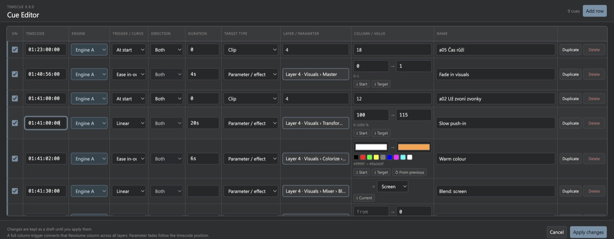

- **Fade** with a start and target value, a duration in seconds (`4s`), frames (`100f`) or timecode, and a linear, ease-in, ease-out or ease-in-out curve
- **Set** a value instantly by leaving the duration empty
- **Continue** from where the previous cue on the same parameter ended by leaving the start value empty
- **Colours** with a colour picker, the parameter's own Resolume palette, and per-channel fades
- **↓ Start / ↓ Target** take the live value from Arena, so a look can be tuned in Resolume and captured without typing numbers

### Pick parameters from the live composition

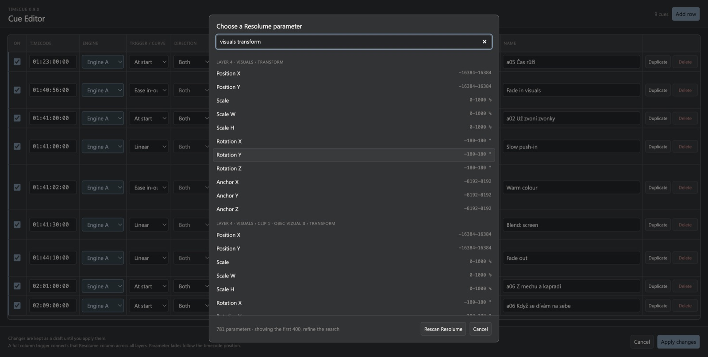

Every numeric, on/off, choice and colour parameter of the composition, its layer groups, layers and clips — including every video and audio effect — is listed with its range and unit. Type a few words to narrow thousands of parameters down.

### See problems before the show, not during it

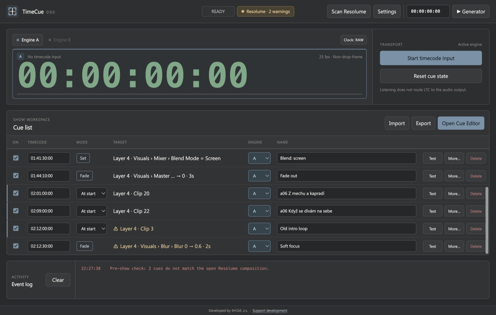

The **Resolume** badge shows whether TimeCue is connected. Whenever Resolume reports its composition — on connect and whenever layers, clips or effects change — every cue is checked against it. Empty clip slots, missing layers and columns, moved or removed effects and invalid values are highlighted with the reason.

### Import SMPTE clips with their offsets

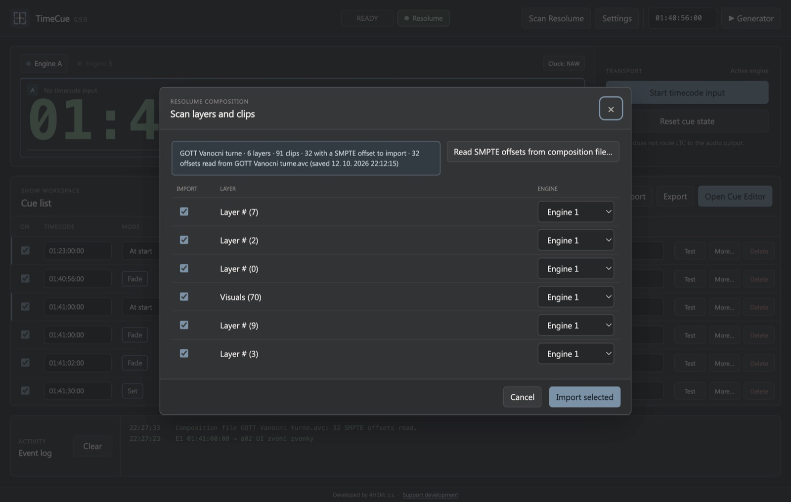

Resolume's API does not report SMPTE offsets, so **Read SMPTE offsets from composition file…** takes them from the saved `.avc` file of the deck that is open in Resolume. Clips are matched by layer, column and name, and Resolume's *SMPTE 1* / *SMPTE 2* inputs map to Engine A and B in dual-engine mode. Save the composition in Arena before reading it.

### Also new

- Bitfocus Companion: Resolume connection and warning variables and feedbacks, a **Stop running test fades** action, and parameter cues in **Trigger a cue now**
- Parameter cues are delivered after a Resolume outage at their current timecode state
- Rescans after an Arena restart update cues instead of duplicating them
- Plain-language connection errors and longer timeouts for large compositions
- Show files with parameter cues need TimeCue 0.9 or newer

## Features

### Two clocks, one clear show state

- One or two independent timecode engines with always-visible clocks
- LTC audio, system MIDI, or native RTP-MIDI source selection independently for each engine
- 24, 25, 29.97 drop-frame/non-drop-frame, and 30 fps timecode
- Forward and reverse decoding with continuity and discontinuity handling
- Raw or delay-compensated clock display

### Clips, columns and parameters

- Trigger a clip by layer and column, or launch a full column across every layer
- `At start`, `At end`, and `During` cue modes with forward, reverse or bidirectional filtering
- Set or fade any parameter: effects, opacity, layer master, blend modes, bypass, choices and colours
- Timecode-locked, smoothed fades with selectable curves
- Composition scan with SMPTE offsets read from the saved composition file
- Manual cue tests, resettable cue state, and `.timecue` show import and export

### Show safety

- Resolume connection badge: connected, connecting, or offline with the reason
- Pre-show check of every cue against the open composition, repeated whenever it changes
- Spreadsheet-style Cue Editor with an explicit Apply/Cancel draft workflow
- No automatic update download, installation or restart during a show

### LTC generation and MIDI timecode

- LTC generator with muted internal loopback or audible output to any soundcard
- MTC quarter-frame and full-frame messages with frame-rate detection
- Built-in AppleMIDI/RTP-MIDI session with Bonjour discovery and per-engine peer routing

### Web remote

- The full Cue Editor in a browser on another computer, including the live parameter picker
- A control page with live timecode, next and last cue, Resolume status, Fire per cue, Generator and Listen
- Edits from the browser and from TimeCue stay in sync; a stale draft never overwrites newer changes
- Off by default and token-protected; tokens never leave the TimeCue computer in show files

### Bitfocus Companion control

- Live clocks, signal health, next-cue countdowns and last-cue results
- Resolume connection and pre-show warning variables and feedbacks
- Generator, input, cue trigger, test-fade stop, cue reset, engine and clock actions
- A coordinated dark preset library for Stream Deck and control surfaces
- Localhost-only by default, with token-protected LAN access

## Interface

### Resolume & timing

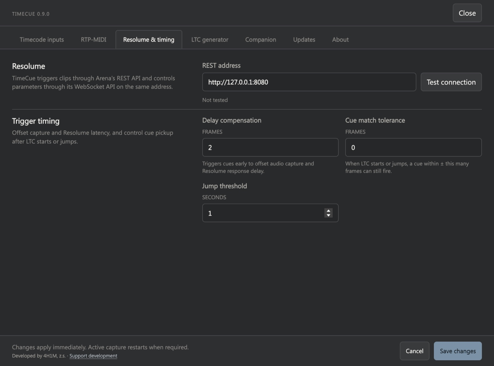

Set the Resolume address, test the connection, and tune delay compensation, cue match tolerance and the jump threshold.

### LTC generator

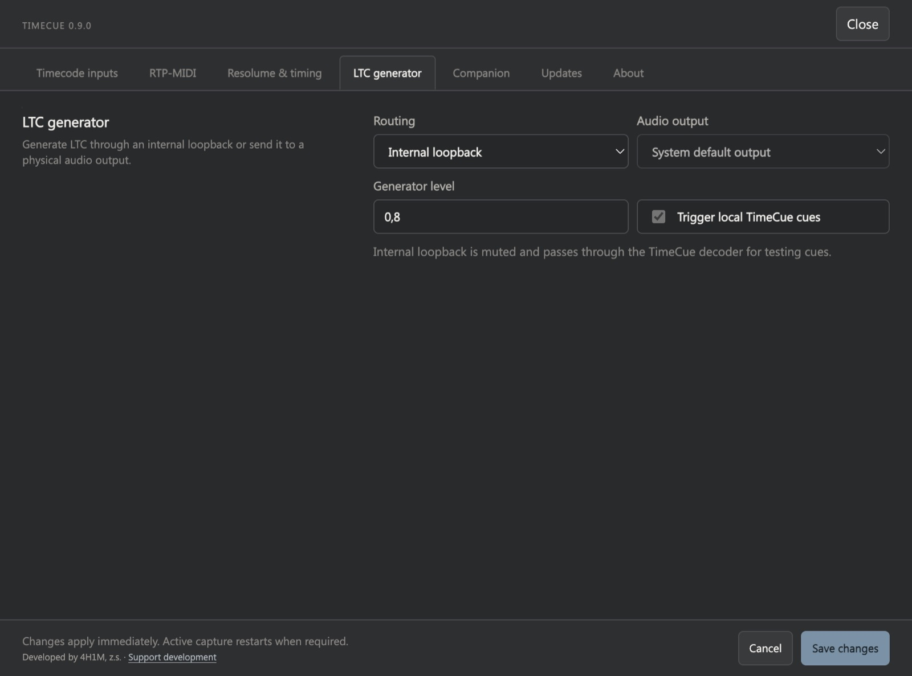

Use a muted internal loopback for rehearsals, or route audible LTC to the system default or a selected physical/virtual audio device.

### Companion

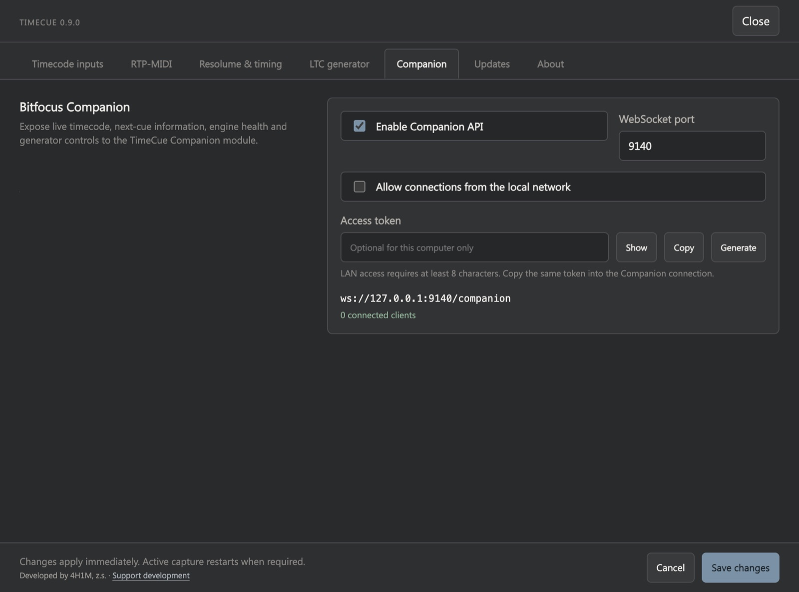

Enable the Companion API on this computer, or allow token-protected connections from the local network.

## Quick start

1. Download and install TimeCue from the [latest release](https://github.com/4H1Mzs/TimeCue-Releases/releases/latest).
2. In Resolume Arena, enable **Webserver & REST API** under `Preferences → Webserver`.
3. In TimeCue Settings, set the Resolume address — usually `http://127.0.0.1:8080` — and select **Test connection**. The **Resolume** badge turns green.
4. Select LTC audio, system MIDI, or RTP-MIDI for Engine A and choose the matching input.
5. Add cues in the Cue Editor, or select **Scan Resolume** and **Read SMPTE offsets from composition file…** to import SMPTE clips. For parameter cues, choose **Parameter / effect** and pick the parameter.
6. Start the real timecode source and confirm a stable lock, the expected cue behavior and no warnings on the Resolume badge before the show.

## Bitfocus Companion

Each release includes an offline Companion module, `timecue-<version>.tgz`. Install it as a custom module in Companion and add a **TimeCue** connection to `127.0.0.1:9140`. For Companion on another computer, enable LAN access in **TimeCue → Settings → Companion**, generate an access token, and enter the TimeCue computer's address and the same token in Companion. Keep port `9140` on a trusted show-control network.

## Web remote

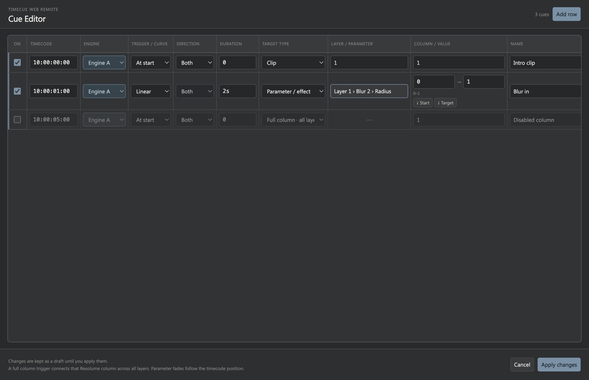

1. On the TimeCue computer, open **Settings → Web remote**, select **Enable web remote** (a token is generated) and **Save changes**.
2. Select **Copy link** and open it in a browser on the other computer. The link contains the token, and the browser remembers it.
3. Use **Fire** to trigger a cue, **Edit** to open it in the Cue Editor, or **Edit cues** for the whole list. **Apply changes** updates TimeCue immediately.

The browser only talks to TimeCue, and TimeCue talks to Resolume with its own address, so Arena's webserver does not need to be reachable from the other computer. Windows asks once whether TimeCue may accept network connections; allow it for private networks. Use the web remote on a trusted show network only: anyone with the token can change cues and trigger them. Generate a new token to sign everyone out.

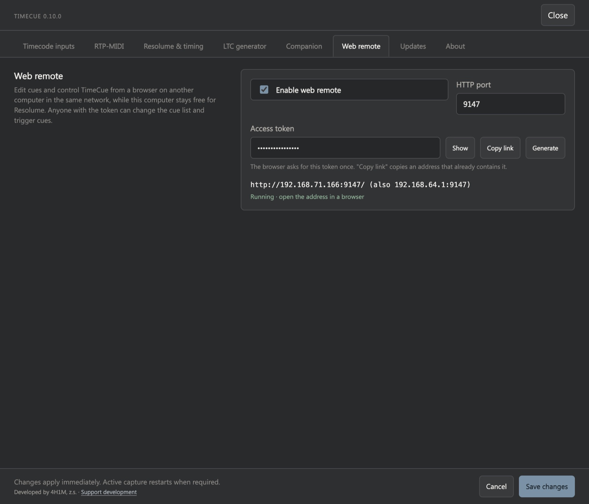

## 4H1M

  

4H1M, z.s. is a Czech nonprofit audiovisual production serving churches and Christian events through sound, lighting, visuals, livestreaming and video. TimeCue is developed as part of that work and is shared to support reliable, accessible show control for live productions.

  

[4H1M.com](https://4h1m.com/) · [Instagram @4h1m.production](https://www.instagram.com/4h1m.production/)

---

  <strong>Built for clocks you can trust and cues you can see.</strong> 
  TimeCue is an independent project and is not affiliated with Resolume.

